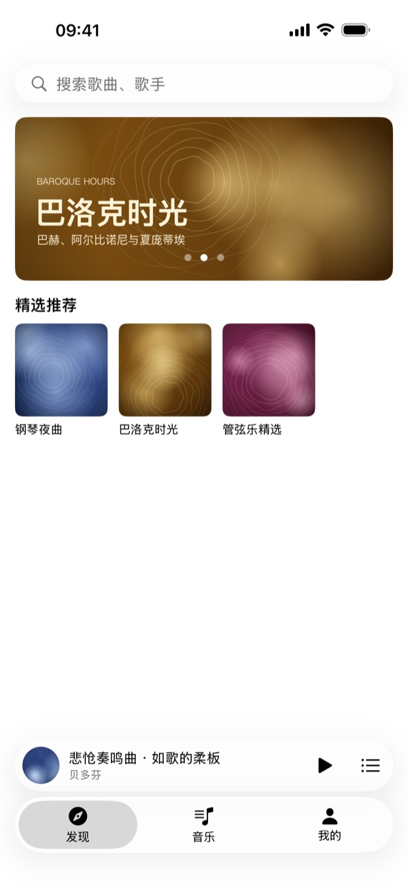
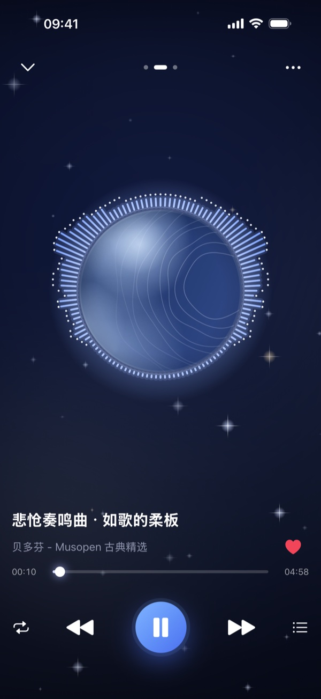
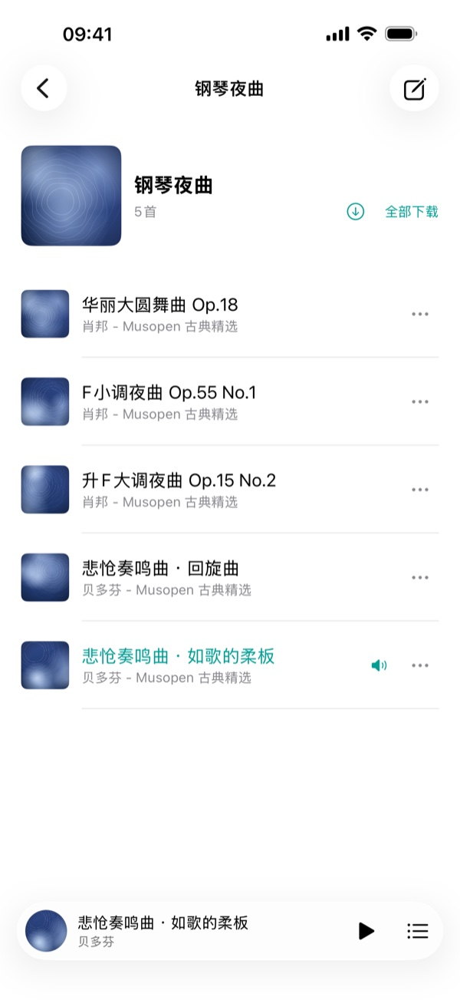
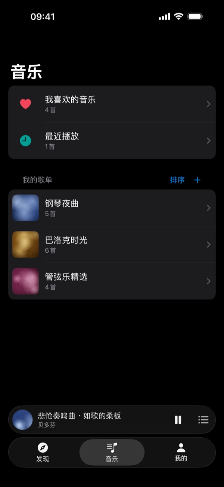

# DairoMUSIC-IOS

[DairoMUSIC](https://github.com/DAIRO-HY/DairoMUSIC) 的 iOS 客户端。

DairoMUSIC 是一个可以自己部署的音乐服务器，这个 App 本身不提供任何歌曲，需要连接你自己（或者朋友）部署的 DairoMUSIC 服务器才能使用。服务器的部署方法请看 [DairoMUSIC](https://github.com/DAIRO-HY/DairoMUSIC)。

## 截图

| 发现 | 播放 | 歌单 | 音乐（黑暗模式） |
|:---:|:---:|:---:|:---:|
|  |  |  |  |

截图中的歌曲是 [Musopen](https://musopen.org/) 的公有领域古典音乐录音，封面和轮播图是程序生成的图案。

## 功能

- **发现**：服务器后台配置的轮播图和推荐歌单
- **搜索**：搜索服务器的曲库；服务器开启了采集服务时，也可以搜索采集平台的歌曲，播放时自动采集到曲库
- **歌单**：创建、编辑歌单（名称、简介、封面），我喜欢，最近播放
- **播放**：后台播放、锁屏和控制中心控制、列表循环、单曲循环、随机播放、定时停止播放、歌词
- **视频**：歌曲有视频（MV）时可以切换到视频播放，支持原画和流畅两种清晰度、全屏横屏播放
- **缓存和离线**：歌曲边播边缓存，没有网络时自动进入离线模式，只播放已经缓存的歌曲
- **下载**：下载歌曲和视频，可以选择音质，视频可以保存到相册（服务器后台可以关闭）
- **音质**：标准（128K）、超高品质（320K）、无损
- **账号**：邮箱或用户名登录、邮箱注册、免注册使用（之后可以绑定邮箱），可以同时登录多个服务器、多个账号并随时切换
- **其他**：歌曲纠错、投诉，意见反馈，VIP兑换（服务器后台开启时），明亮/黑暗主题

## 运行环境

- iOS 16.0 及以上，支持 iPhone 和 iPad
- 编译需要 Xcode 16 及以上

## 编译

项目依赖两个 Swift Package，目前以本地路径引用，需要先把它们 clone 到对应的位置：

| 依赖 | 说明 | 本地路径（相对于本项目目录） |
|---|---|---|
| [DairoUI_IOS](https://github.com/DAIRO-HY/DairoUI_IOS) | 设置页风格的 UI 组件、Toast 等公共工具 | `../DairoUI_IOS` |
| [DairoDFS](https://github.com/DAIRO-HY/DairoDFS) 的 iOS SDK | 文件下载、边播边缓存、离线文件管理 | `../../java/idea/DairoDFS/dairo-file-sdk/platforms/ios` |

目录结构如下（`dev` 可以是任意目录）：

```
dev/
├── java/idea/DairoDFS/      DairoDFS
└── xcode/
    ├── DairoMUSIC-IOS/      本项目
    └── DairoUI_IOS/
```

也可以放在其他位置，在 Xcode 里删除原来的本地 Package，重新添加你的路径即可。

### 1. 编译 DairoDFS 的 iOS SDK

SDK 用 Rust 编写，编译好的 `DairoFileSDKFFI.xcframework` 没有提交到仓库，需要自己编译一次。需要安装 [Rust](https://www.rust-lang.org/)（stable 版本）：

```bash
rustup target add aarch64-apple-ios aarch64-apple-ios-sim x86_64-apple-ios aarch64-apple-darwin x86_64-apple-darwin
cd DairoDFS/dairo-file-sdk/platforms/ios
./build.sh
```

### 2. 打开项目

用 Xcode 打开 `DairoMUSIC-IOS.xcodeproj`，在 Signing & Capabilities 里把 Team 改成你自己的开发者账号，Bundle Identifier 改成你自己的，然后运行即可。

第一次打开 App 时输入服务器地址（例如 `192.168.1.100:8020`），再登录或注册。

## UI 测试

`DairoMUSIC-IOSUITests` 是连接真实服务器运行的 UI 测试，需要先启动一个测试用的 DairoMUSIC 服务器。

- 服务器地址通过环境变量 `SERVER` 传入，默认 `127.0.0.1:8020`；用 `xcodebuild` 运行时环境变量要加 `TEST_RUNNER_` 前缀
- 账号相关的测试（注册、重置密码、绑定邮箱）需要服务器用 `--mock-email` 参数启动，验证码不会真的发送邮件

```bash
TEST_RUNNER_SERVER=127.0.0.1:8020 xcodebuild test \
  -project DairoMUSIC-IOS.xcodeproj -scheme DairoMUSIC-IOS \
  -destination 'platform=iOS Simulator,name=<你的模拟器名称>' \
  -only-testing:DairoMUSIC-IOSUITests/DairoMUSICUITests
```

## 隐私政策

[PRIVACY.md](./PRIVACY.md)

## 开源协议

[Apache License 2.0](./LICENSE)
